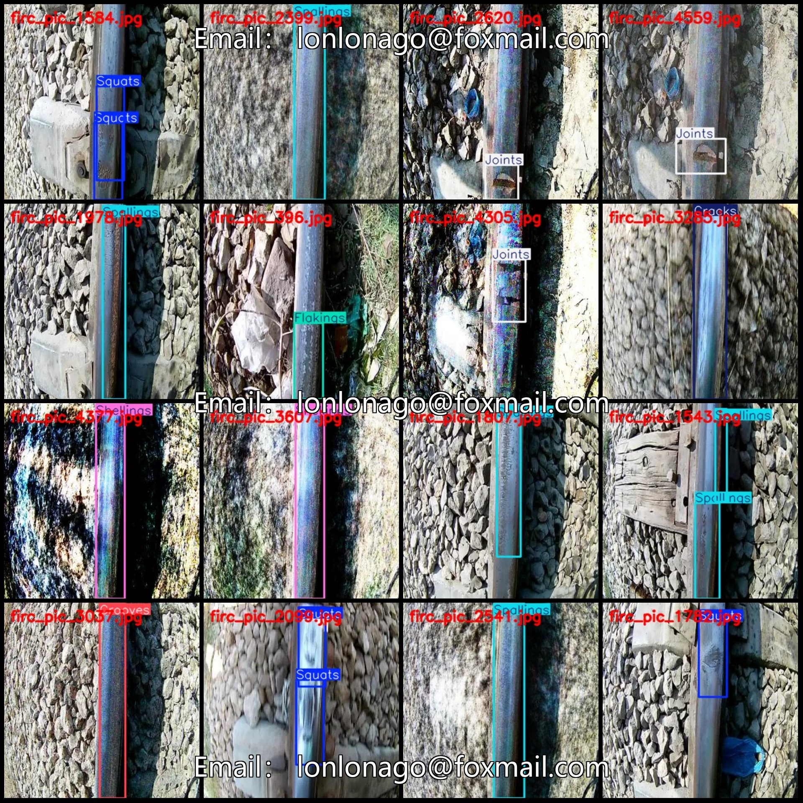
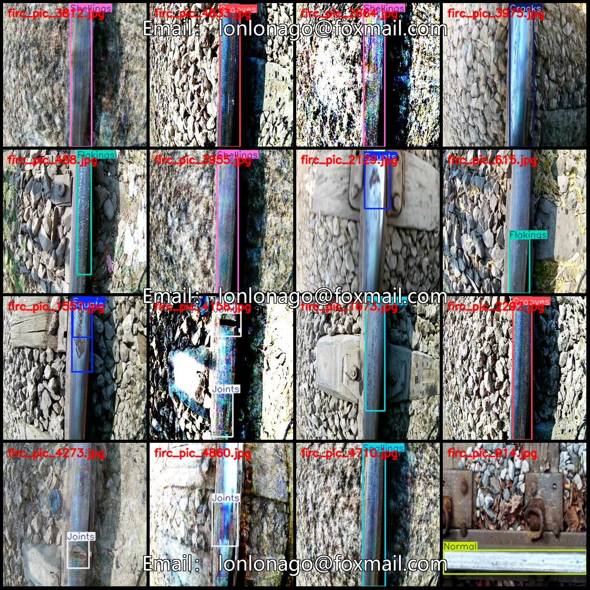
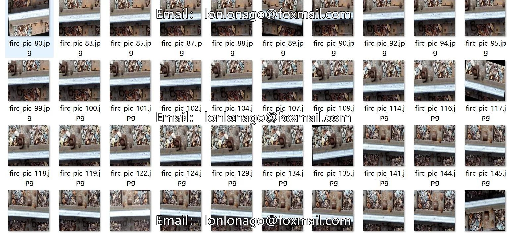
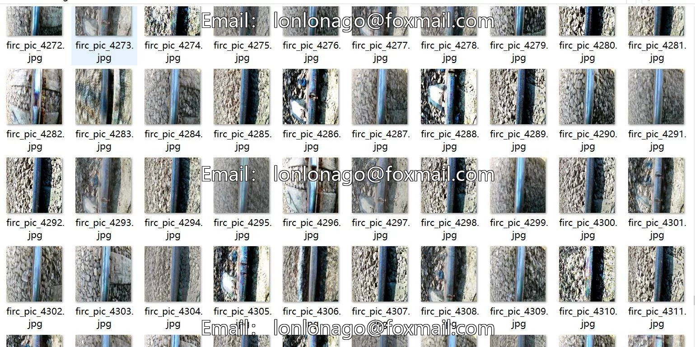
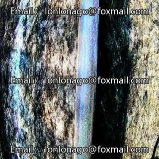
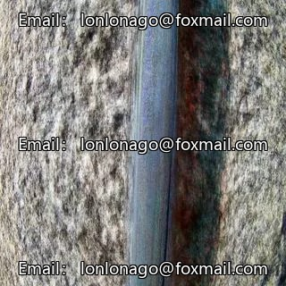

# UAV-viewpoint low-altitude railway track defect detection dataset VOC+Y

## Body

Drone-viewpoint Low-altitude Railway Track Defects Recognizable and Loose Cracks Detection Dataset VOC+YOLO format with 4599 images in 8 categories
Warm Reminder: Due to the dataset's replicability, please confirm compliance before purchasing.
Please note that the resolution of the dataset is relatively small, only 320x320, which may not be very clear. Please carefully review the image examples for your own discretion.
Different people have different opinions; some might consider it not captured by a drone. You can refer to the provided images for your own judgment.
The dataset format: Pascal VOC format + YOLO format (excluding the segmentation path in the txt file, only including jpg images and corresponding VOC format xml files and yolo format txt files).

Number of images (jpg file count): 4599
Number of annotations (xml file count): 4599
Number of annotations (txt file count): 4599
Number of annotation categories: 8
Annotation category names (Note that the order in yolo format does not correspond to this, but is based on the classes.txt in the labels folder): ["Cracks", "Flakings", "Grooves", "Joints", "Normal", "Shellings", "Spallings", "Squats
Number of boxes per category
Cracks (cracks) = 632

Flakings (Scale-like detachment) Frames = 631
Grooves (Recesses) Frames = 633
Joints (Seams) Frames = 670
Normal (Normal) Frames = 351
Shellings (Loosening/Pitting) Frames = 643
Spallings (Cracking/Bleaching) Frames = 694
Squats (Surface Collapse/Falling) Frames = 630
Total Frames: 4884
Number of Images per Category
Cracks (Leaks) Number of Images = 631
Flakings (Scale-like Detachment) Number of Images = 594

Grooves (Ditches) occupies = 631
Joints (Seams) occupies = 607
Normal (Normal) occupies = 350
Shellings (Loss of Blocks) occupies = 631
Spallings (Cracking/Scaling) occupies = 631
Squats (Surface Collapse/Falling) occupies = 525
Image resolution: 320x320
Using labelImg for annotation tool
Annotation rules: Draw a rectangle around the category.
Important note: The dataset does not have split into training, validation, and test sets; you need to manually divide it.

Special : This dataset does not guarantee the accuracy of the trained models or weight files. After purchase, it represents acknowledgement that the dataset has been sold.

## Images

## Payment

Here is a pay link on Stripe ( https://buy.stripe.com/3cs8yP7sY87d0vu9AB ). Please contact me lonlonago@foxmail.com after funding $89, and I will send you a complete data files , thank you!

